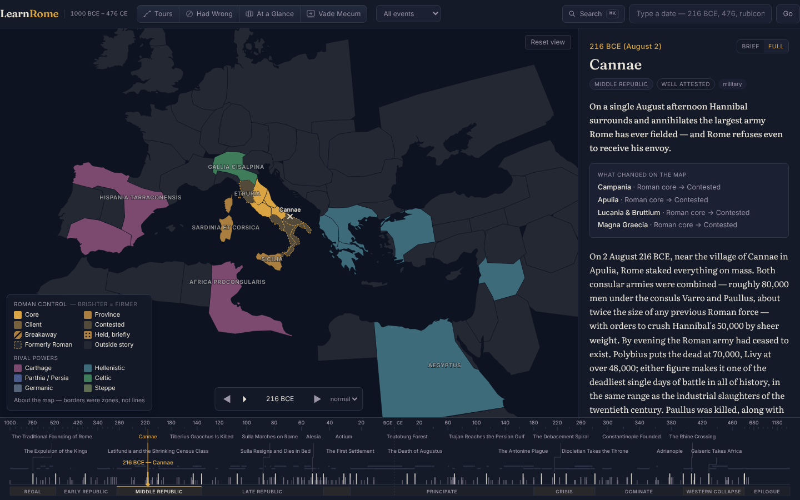
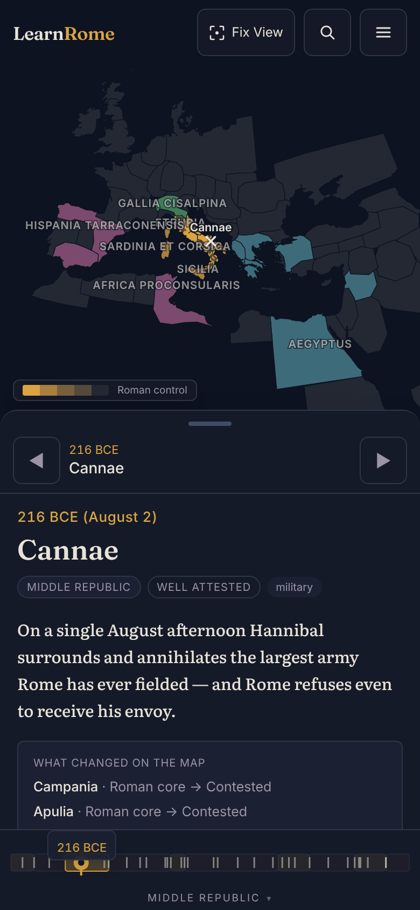

# LearnRome

Roman history, 1000 BCE to 476 CE (with the epilogue to 1453), taught through
a map of the Mediterranean that redraws itself as you move through time.

Type `216 BCE` and Hannibal is standing inside Italy while Rome holds nothing
beyond it. Step forward event by event and watch the provinces fill in, break
away, and go dark. Geography is the memory scaffold; the map is the product.



## What's in it

- **224 events** across thirteen eras, around 95,000 words of original prose,
  each with a brief and a full reading depth, sources with honest notes, and
  reliability chips (legendary, contested, reconstructed).
- **82 misconception callouts**, from "the Empire fell in 476 AD" to "gladiator
  fights were Rome's most popular entertainment", with an index you can browse
  on its own.
- **A map that moves.** 72 regions, each with a control status per event
  (core, province, client, contested, breakaway, lost...) folded from deltas, so
  the picture at any year is exactly the sum of what came before. Click a
  region for its full history.
- **A density-aware timeline** you can scrub, type a date into, or step through.
  Centuries with more going on get more room. Era bands zoom.
- **Seven guided tours**, from the fifteen-minute overview to "Why the west
  fell", plus a surprise-me button.
- **Mobile layout** with a draggable sheet and a thumb-friendly rail, chosen by
  viewport width so "request desktop site" still works.

Everything is static. There is no server, no account, no analytics and no
network call at runtime.

<p>
  
</p>

## Run it

```bash
npm install
npm run dev        # http://localhost:5173
npm test           # 77 tests: date parser, control resolver, timeline scale, corpus validators
npm run build      # production build in dist/
```

Node 22 or newer.

## How it works

Vite + React + TypeScript, with D3 (`d3-geo`, `d3-zoom`) rendering SVG
directly through a conic conformal projection tuned to the Mediterranean.

The territory model is the interesting part. Regions are a fixed set of
polygons (derived from public-domain Natural Earth coastlines by
`scripts/build-regions.mjs`). Each event carries a *delta* of control changes,
not a full state, and `src/lib/resolveControl.ts` folds the deltas in year
order to get the state at any index. The control deltas for every event are
pinned in the manifests under `docs/content/`, and
`src/data/events/validate.test.ts` asserts the resolved state at a dozen
checkpoint years, so the thirteen era modules cannot quietly drift apart.

Prose is 86% of the corpus by bytes, so it lives in per-era chunks loaded on
demand; `npm run build:corpus` regenerates them from the era modules (dev and
build do this automatically). The timeline uses a piecewise-linear scale whose
segment widths come from event density (`src/lib/timelineScale.ts`).

Add `?dev=audit` in development for a region x event control heatmap.

More in [docs/DESIGN.md](docs/DESIGN.md) (visual language),
[docs/content/AUTHORING.md](docs/content/AUTHORING.md) (writing events),
[docs/DEPLOYMENT.md](docs/DEPLOYMENT.md) (headers and caching for a static
host) and [docs/ATTRIBUTION.md](docs/ATTRIBUTION.md) (data and font licences).

## Licence

MIT. Map data is derived from Natural Earth (public domain); typefaces are
under the SIL Open Font License.
